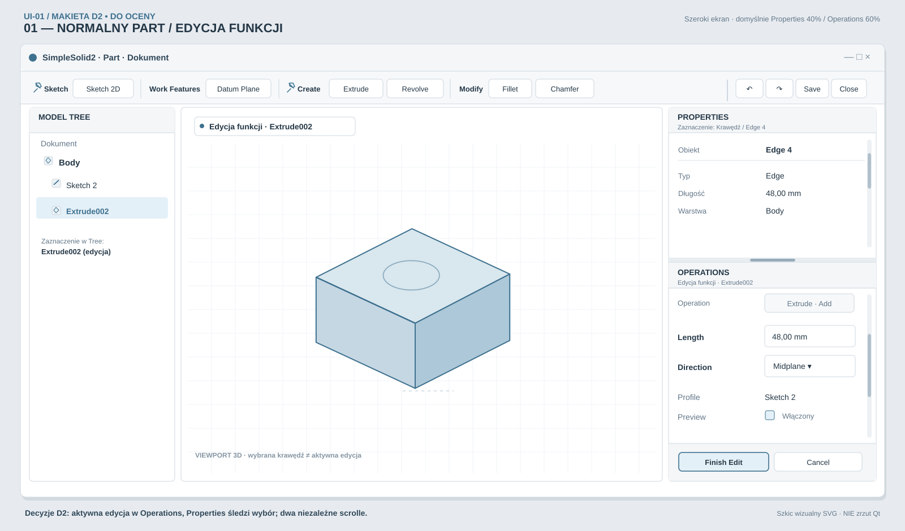
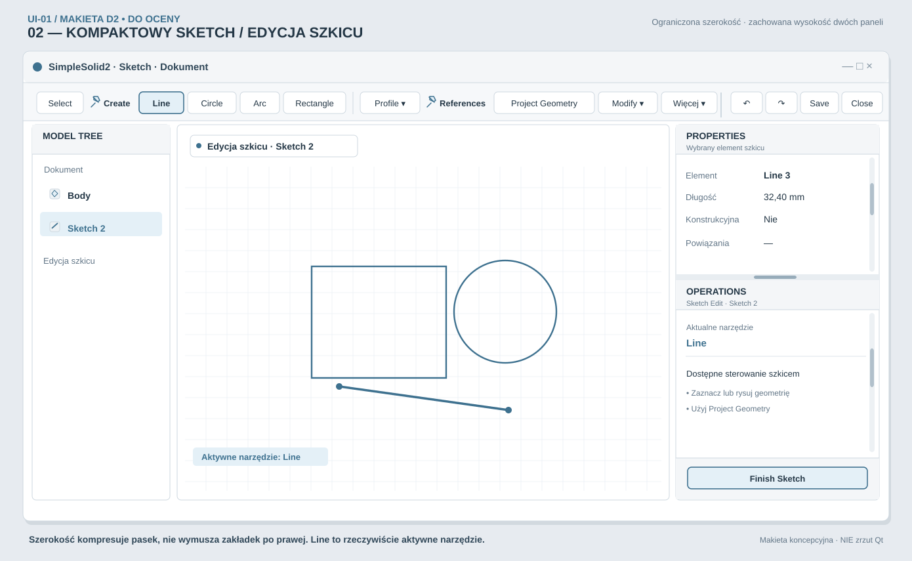
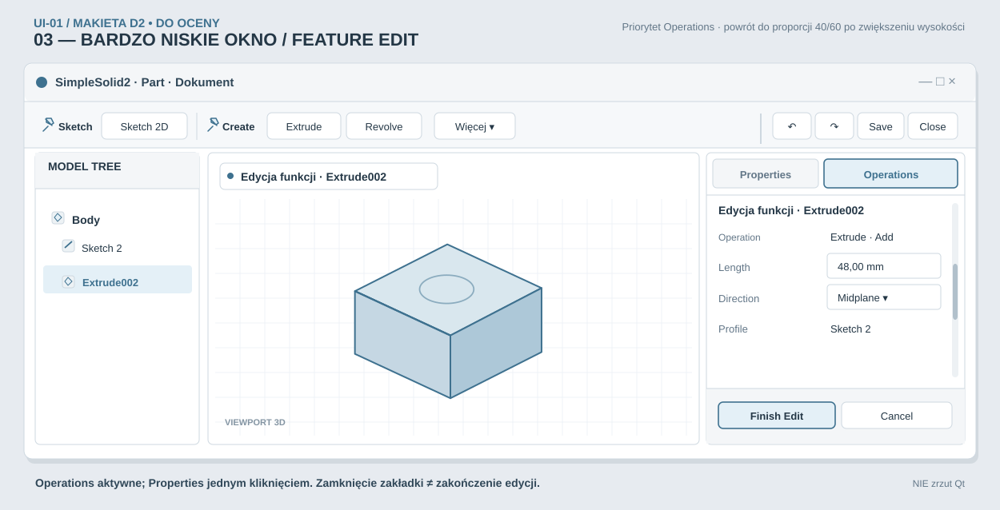

# UI-01 — Zestaw trzech makiet wizualnych Workbencha — do końcowego przeglądu Ownera

> **STATUS: OWNER ACCEPTED — FINAL CONSOLIDATED D2 SVG VISUAL CONCEPT (2026-10-11).** Owner reviewed the **three-mockup set as a whole** and explicitly replied **`akceptuję zestaw`** to the question whether these normal Part / compact Sketch / short-height Feature Edit SVG mockups matched the intended Workbench and could conclude D2 design review. This is **final acceptance of the conceptual D2 arrangement and presentation portrayed by these three static SVGs**, not acceptance of real Qt implementation, pixel-perfect native screenshots, unmeasured DPI/layout thresholds or actual icon artwork. The SVGs are still **not screenshots of the application**; native usability, accessibility, focus/hover behavior and Windows exact-head regressions remain **implementation FINAL PASS** gates. No Work Contract, ACTIVE activation, code change or merge approval follows automatically.

**Kontekst:** [PR #320 — governance-only D2 proposal](https://github.com/MechanicalCave/SimpleSolid2/pull/320); szczegóły wcześniej zaakceptowanych decyzji w [rejestrze UI-01](UI-01_RIGHT_PANELS_AND_TOP_TOOLBAR_DESIGN_REVIEW_OPTIONS.md), macierz zachowań w [wireframes D2](UI-01_RESPONSIVE_WORKBENCH_WIREFRAMES_D2_REVIEW.md).

## 01 — Normalny Part / Edycja istniejącej funkcji

[Otwórz grafikę 01 w pełnym rozmiarze](UI-01_VISUAL_REVIEW_01_NORMAL_PART.svg)

**Co oceniać:** jeden rząd z nazwami grup; małe, pasywne pinezki przy przypiętych grupach; osobne Undo/Redo/Save/Close. Nad Viewportem rzeczywisty tryb `Edycja funkcji · Extrude002` i ten sam draft w Operations; Properties śledzi odrębny wybór `Edge 4`. Domyślne 40%/60% dla paneli z regulowanym separatorem i niezależnym przewijaniem. Finish Edit i Cancel na dole Operations, poza przewijanym formularzem. `Extrude` na górnym pasku nie jest automatycznie zaznaczony tylko dlatego, że edytowana jest istniejąca Extrude002.

## 02 — Kompaktowy Sketch / Edycja szkicu

[Otwórz grafikę 02 w pełnym rozmiarze](UI-01_VISUAL_REVIEW_02_COMPACT_SKETCH.svg)

**Co oceniać:** zmniejszenie szerokości adaptuje **jednorzędowy pasek**, lecz nie przełącza samoistnie prawych paneli na zakładki; Properties i Operations są widoczne jednocześnie, dopóki starcza wysokości. `Line` jest aktywnym narzędziem Sketch (podświetlenie przycisku), nie oznaczeniem edycji istniejącej funkcji. Domyślna kolejność: Select, Create, Profile, References, Modify, Transform, Inspect; `Select` pozostaje samodzielną akcją, część niezapiętych grup reprezentują nazwane menu, `Więcej` jest ostatecznym overflow. Pokazany jest wyłącznie rzeczywisty `Finish Sketch` — **nie wynaleziono `Cancel Sketch`**.

## 03 — Bardzo niskie okno / Edycja funkcji

[Otwórz grafikę 03 w pełnym rozmiarze](UI-01_VISUAL_REVIEW_03_SHORT_HEIGHT.svg)

**Co oceniać:** spadek użytecznej **wysokości** przełącza prawą kolumnę z dwóch paneli na `Properties | Operations` w jednym miejscu. Podczas Feature Edit domyślnie aktywny jest Operations; Properties pozostaje jednym kliknięciem, a przyciski Finish Edit i Cancel są stale na dole Operations. Kliknięcie zakładki, scrollowanie czy zmiana rozmiaru nie kończy draftu ani nie wprowadza zmian do Undo/Document. Po zwiększeniu wysokości przywracany jest ręcznie ustawiony w sesji podział, domyślnie 40/60.

## Stan decyzji i granice tej oceny

**Owner zaakceptował osobno:** T-A (adaptacyjny, jednorzędowy pasek), treść/kolejność/przypinanie grup, dopuszczalne poziomy zwinięcia, `Więcej → grupa → narzędzie`, dyskretny techniczny styl, kompaktowe proporcje (orientacyjnie ikony 18–20, przyciski 32–36 pikseli logicznych przy 100% DPI), mode cue, rozdział Properties/Operations, 40/60 i zachowanie przy bardzo niskim oknie. Przyjęte jest bezpieczeństwo P0: Sketch Edit nie może współistnieć w konflikcie z Feature Draft. Żadna aprobata częściowa nie stanowi ostatecznego UI-01 D2 visual PASS.

**Owner D2 końcowo zatwierdził trzy makiety jako jeden zestaw (2026-10-11):** wspólny kierunek kompozycji, zachowania i stylu jest zaakceptowany. **Pozostały do oceny na rzeczywistym Qt/Windows:** dokładne proporcje Tree/Viewport/prawa kolumna w konkretnych DPI, marginesy i typografia, docelowe grafiki operacji CAD, rozróżnialne focus/hover/active/disabled, ostateczne polskie i angielskie etykiety, działanie popupów i ich obsługa klawiaturą, długie formularze i dostępność Finish/Cancel oraz brak kolizji ViewCube z mode cue. Ikony i scena CAD nadal są poglądowe, a nie gotowymi assetami ani wzorcowymi rysunkami geometrii. Te rzeczy wymagają native QA i osobnego Owner UI-01 FINAL PASS po implementacji — nie kolejnej zgody na ten sam statyczny zestaw.

**Wymagana dalsza weryfikacja:** na prawdziwym Windows/Qt potwierdzić m.in. 100/150/200% DPI, minimalną rzeczywistą szerokość viewportu, wielkość fontów, responsywne breakpointy z histerezą, focus klawiatury, długie formularze, brak widocznego przesuwania szerokości przez pojawiający się scrollbar, niezawodność tabs↔split oraz fail-closed P0. SVG nie zastępuje Windows QA.

**Nie wolno uznawać wyłącznie na podstawie tych SVG:** finalnej jakości interfejsu, Work Contract, aktywacji `work/ACTIVE.yaml`, gotowości do implementacji, zmian w `main`, zgody na merge ani PG-01E/PM-06. Po wyraźnej finalnej zgodzie Ownera D2 następnym *odrębnym* krokiem byłby osobny ograniczony UI-01 Work Contract; potem osobna aktywacja i testy exact-head Windows.
